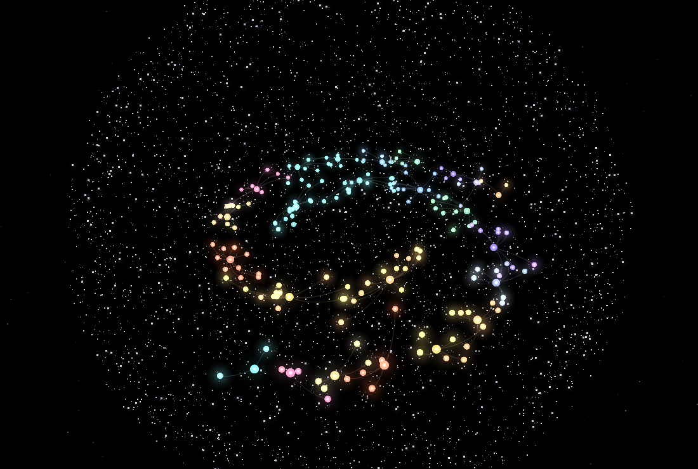
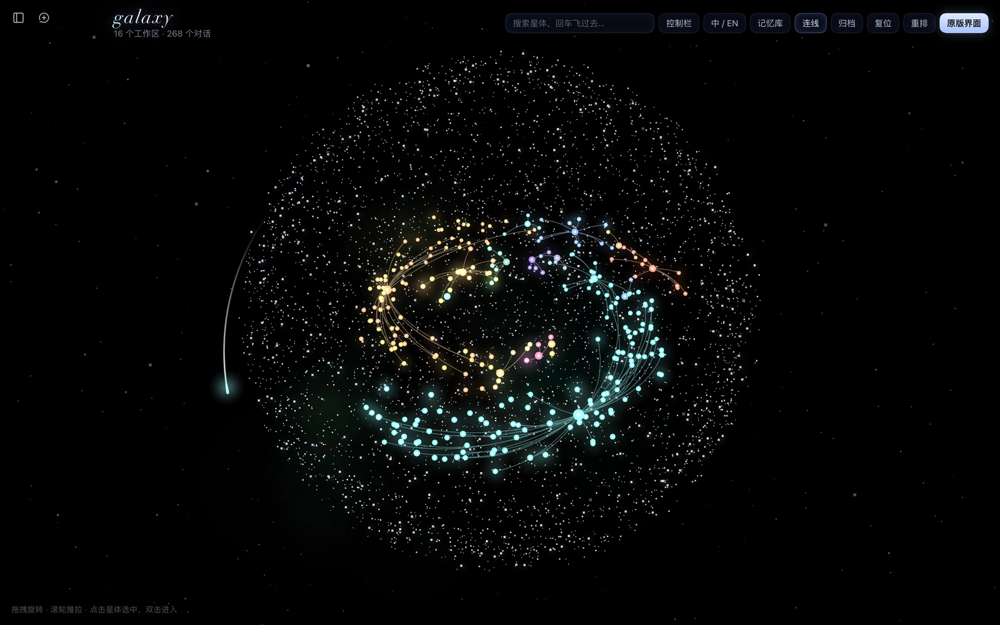
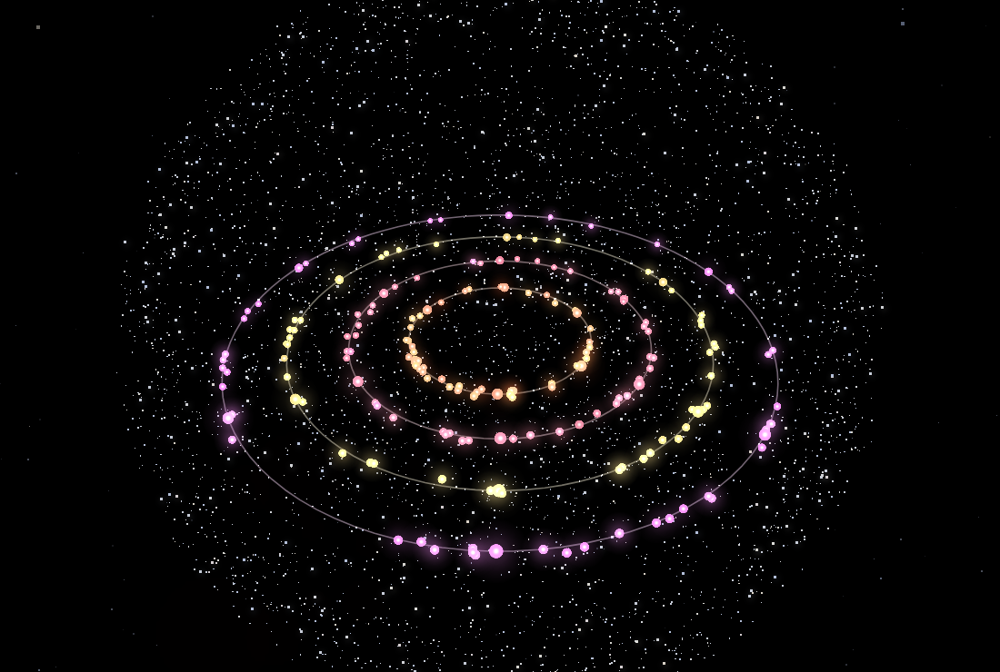
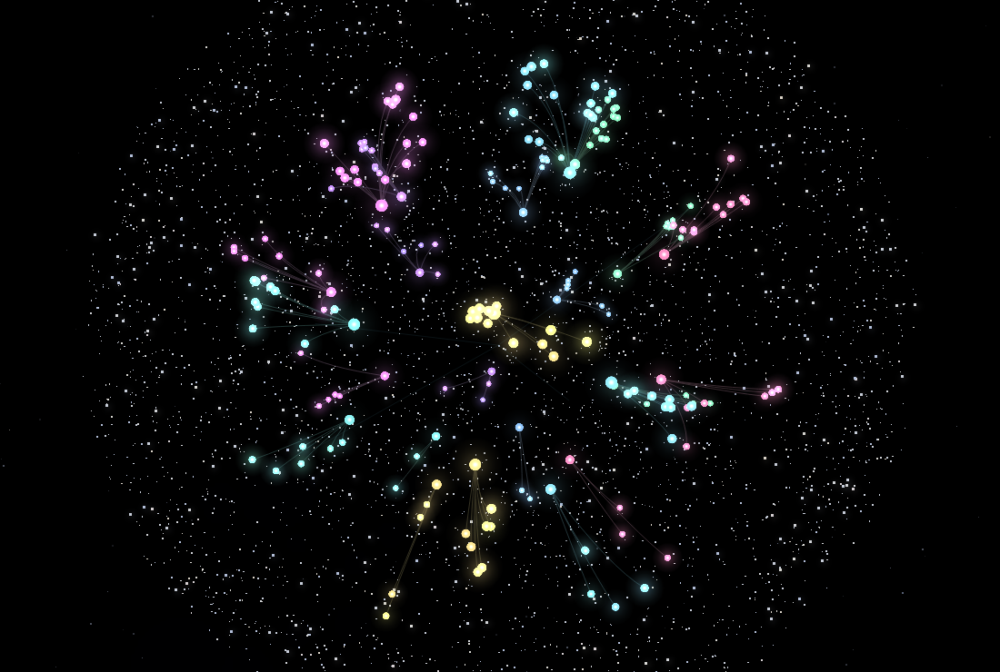
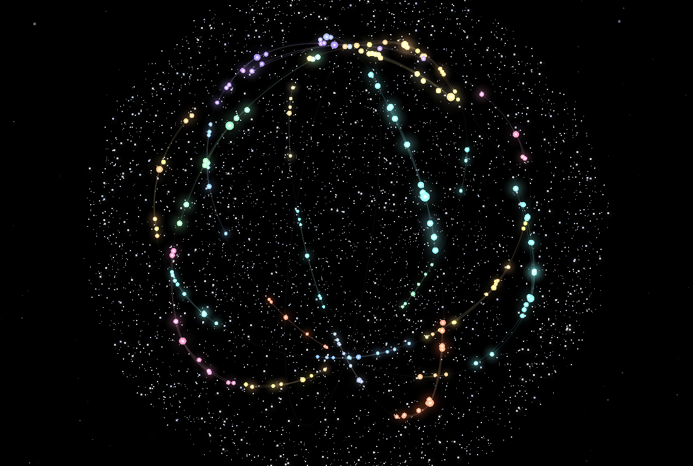

# dsh-galaxy-view · Galaxy view

[中文](README.md) · **English**

Every workspace and conversation in DeepSeek Harness, drawn as a **three-dimensional galaxy** — fly between the stars like NASA's [Eyes on Asteroids](https://eyes.nasa.gov/apps/asteroids/#/home).





Workspaces are suns on spiral arms, conversations are small sharp stars circling them, and fork / subagent lineage draws a thin filament. The camera turns on its own — drag to take over, scroll to dolly. Click a star and the view dives into that conversation, landing inside a hollow sphere of dots; **Back to the galaxy** flies you out again.

The star recipe, palettes and camera feel follow Obsidian's [Galaxy View](https://community.obsidian.md/plugins/galaxy-view) (a cinematic 3D graph in the NASA Eyes style); the data is Harness's workspaces and sessions.

## Highlights

- **A working scene you can read** — suns are workspaces (hue fixed by order, dot grows with its conversation count), stars are conversations (running ones pulse), filaments are membership and lineage, the current session wears a white ring, and archived stars only appear with *Archived* on.
- **A hollow shell of dots** — 5200 grains at 1.2 px, 1800 at 2 px and 500 at 3 px in seven muted near-white tints, plus 780 field stars inside. The shell shares the galaxy's camera and is centred on it, so diving into a star moves you **through** it instead of dragging a backdrop along.
- **A warp, not a page switch** — dive in the real scene first (980 ms for a conversation, 1150 ms for a workspace), accelerate the grains into a 1 px band, then close into a hollow shell in that star's colour with a ripple of hard square dots. The overlay fades only once the target panel has mounted; with *Reduce motion* it becomes a crossfade.
- **Sharp, non-plastic stars** — opaque solid discs with a white-hot centre that never clips to pure white and a tight coloured halo. At overview a conversation is a small star (a workspace is bigger with more conversations in it), it scales up as you fly closer, and selecting one only lightly dims the rest. Baked at device resolution with 4×4 supersampling and cached, so a frame allocates nothing.
- **Eight layouts** — Galaxy, Rings, Armillary, Solar system, Helix, Matrix, Cube, Tree. A preset switches the whole geometry (positions, dust and the guide skeleton follow it), and the solar system really revolves: planets around the sun (inner fast, outer slow), moons around their planet.
- **Eight presets × eight palettes** — a preset is a whole look (theme, glow, deep-space layers, shell, arms, link curve, twinkle, orbit speed): hover to preview, click for a 560 ms dissolve. Eight palettes (Deep Field, Hubble, Neon, Sunset, Cyber, Matrix, Aurora, Solar) all draw on pure black, with colour only from stars and links; save up to 8 presets of your own (double-click to rename, ↑ to reorder, × to delete).
- **Playable physics** — repulsion, link distance, link strength, centre pull, flatten, core gravity and swirl are a force layer on top of the analytic layout: the defaults converge back to the preset's silhouette, each frame gets about a 4 ms budget, and it sleeps once settled. The four *shape* sliders re-solve the disc instead.
- **Only real relationships drawn** — links are workspace→conversation membership and parent→child lineage, never invented edges. Width, opacity, bow and colour (star colours, a swatch, any colour) are adjustable; the header button hides them, and with links off a clicked conversation still shows only its own.
- **Memory library** — a second view behind the same panel: the instruction files that shape agents, the skills that can load, and how often each was called. Click a row to read the file into the editor on the right; `⌘S` writes it back, an edit from elsewhere comes back as a conflict, and files shipped inside the app stay read-only.
- **Keyboard and search** — `Tab` / `Shift+Tab` walk the stars and pop their cards, `Enter` dives, `F` / `R` fly to the selection and back to overview, `Esc` cancels; the header search flies to any conversation, and clicking one in the Harness sidebar flies to its star without leaving the galaxy.
- **Status lenses and filtering** — All / Running / Current / Subagent / Archived, with non-matches dimmed but still clickable; one row per workspace, click to hide and double-click to keep only it; the filter box keeps Galaxy View's grammar (space = AND, `-word` excludes, `path:` / `name:` narrow the field, `"phrase"` for spaces).
- **Four quality tiers** — auto / high / low / mobile. Auto steps down above 19 ms and up below 14.5 ms, with no flapping inside 1.5 s; the mobile tier drops glow and mist and draws at most 1500 stars.
- **Two languages, zero runtime dependencies** — the UI follows the system language or switches between 中文 and English; it uses only the loader's `react` and the host's existing `ctx.*` services. Drawing goes through a hand-written WebGL2 point pass that falls back to Canvas 2D on failure.

## Install

Requires **DeepSeek Harness Desktop** (with the `main` panel slot and the `uiWorkspace` service). Browser code plus one host half — no native dependencies.

**From the plugin market** (once published): search `dsh-galaxy-view`.

**From npm into a profile:**

```bash
cd "$DSH_HOME/profiles/web"
pnpm add dsh-galaxy-view        # or: npm install dsh-galaxy-view
```

**From a local checkout (development):**

```bash
node scripts/install-into-profile.mjs                    # default web profile
node scripts/install-into-profile.mjs --profile PATH     # explicit profile
```

`dsh.bundle.patch` inserts the plugin row into the layer stack. Restart Harness (or reopen the window) afterwards: a **Galaxy** button appears at the right of the header in any conversation — click it to open the galaxy, and **Original UI** or the capsule inside a star brings you back.

## Usage

Two headers: **Galaxy** in the conversation header opens the view; the galaxy panel's own header carries **Links** (show or hide), **Memory** (switch to the second view), Archived, Reset, Re-roll, the language switch and the search box. The left panel collapses with ☰ and resizes by dragging its right edge (240–480 px); every slider carries a default tick, and double-clicking a slider or its label returns it to that default. All settings live in `localStorage`, including each section's expanded state.

### The eight layouts

| Preset | Layout | Reads as |
| --- | --- | --- |
| Galaxy 银河 | `spiral` | a two-armed disc with a sparse core |
| Rings 星环 | `rings` | four concentric orbits, one colour per ring, no links; every body travels its own ring in a double helix |
| Armillary 浑天 | `sphere` | an armillary sphere: five same-radius rings, each tilted into its own plane (golden-angle spread) so their union is a ball; bodies dealt onto the rings by weight, each ring spinning inside its own plane |
| Solar system 太阳系 | `system` | a spherical sun of warm dust at the centre, one planet per workspace on its own nested orbit, each wrapped in a shell of its conversations — and the whole system revolves |
| Helix 双螺旋 | `helix` | two strands climbing 1.6 turns, workspaces split between them by star count so both carry the same number of stars over the full height |
| Matrix 矩阵 | `web` | one lumpy ball of green dots and straight links, no glow, no backdrop |
| Cube 方阵 | `plate` | a solid cube: every star on one lattice, each workspace a block of it, the twelve edges drawn |
| Tree 星树 | `tree` | a pure starburst: every workspace owns a ray out of the origin, spread over the sphere by the golden angle, a heavier workspace reaching further, its conversations in a tube that widens outward |

| Rings | Tree | Warp |
| --- | --- | --- |
|  |  |  |

### Reading the galaxy

| On screen | Meaning |
| --- | --- |
| coloured sun | one workspace; hue fixed by workspace order, dot grows with its conversation count |
| stars around a sun | that workspace's conversations; running ones pulse |
| faint thread | membership; fork / subagent to parent is a brighter bowed thread |
| drifting dust | arms and a diffuse disc (the *dust lanes* slider, off by default) — backdrop, not clickable |
| hard white dot sphere | the sky shell: a true 3D shell of points sharing the galaxy's camera and centred on it |

### Interaction

| Input | Result |
| --- | --- |
| drag | orbit with inertia; auto-orbit resumes 1.6 s after release |
| scroll | dolly, accumulating across a scroll, up to about 4.5× the default distance |
| click a star | the camera dives and a card appears: title, path, time and status; its neighbourhood stays bright (depth 1 or 2) while the rest dims |
| double-click | skip the card and warp straight in |
| `Tab` / `Shift+Tab` | walk the stars; `Enter` dives or opens the current one |
| `F` / `R` / `Esc` | fly to the selection / back to overview / cancel focus and selection |
| header search | type a title or path, pick with the arrow keys, and the camera flies there |
| a conversation in the sidebar | clicking it while the galaxy is open flies to its star instead of leaving the view |
| Archived / reset / reshuffle | show archived stars / return to the default camera / deal a new disc from another seed |
| ☰ | collapse or expand the left panel |

### The warp

Diving into a star dives toward it in the real scene, accelerates a ring of fine dots into a 1 px band, and closes into a hollow shell in that star's colour. Inside a workspace or conversation that shell stays on screen as the room you are in: the same sphere, grown past the frame so no rim is visible, every dot the same size and brightness, two layers turning slowly against each other, plus an inner halo in the body's colour and the **Back to the galaxy** capsule (which plays the warp in reverse).

Opening the galaxy collapses the Harness navigation sidebar to give the scene the full width; leaving restores the width it had.

### Memory library

The **Memory** button swaps the galaxy for a second map: golden bodies in the core are instruction files (`AGENTS.md`, `CLAUDE.md`, `prompt-inject.md`, `rules/*.md`, a workspace `README.md`), teal bodies on the arms are skills (hue by source, size by call count), and the small stars orbiting them are calls — past 16 only counted, not drawn.

The Node half discovers that library itself — the DSH home, `~/.agents`, each workspace's `.dsh/skills` and `.agents/skills`, vendor and extension directories — and reads skill calls back out of every session log (plain `.jsonl` and append-only `.zstd` alike). Adding this view to an already running DSH needs a restart: the Node half mounts with the host process, not with the page.

## Control panel

| Section | What is in it |
| --- | --- |
| Appearance | eight preset cards, hover to preview, click for a 560 ms dissolve; palette (eight themes), shuffle colours, node size and what it follows (activity / links / uniform), star twinkle |
| Filter | one row per workspace with its colour and conversation count: click to hide, double-click to keep only it; orphans and empty workspaces toggle separately; the filter box takes the grammar above |
| Status | the five lenses, non-matches dimmed but clickable |
| Links / Deep space / Glow / Shape / Physics | link visibility, width, opacity, brightness, bow, colour; nebula veil, field stars, cluster mist, dust lanes, shell density/size/brightness; star brightness, glow strength, radius, threshold; arms, twist, thickness, spread; the seven physics sliders |
| Navigation | auto-orbit and speed, tour and speed, selection depth, **Connect two** (pick two stars and fly the shortest link path hop by hop), replay the reveal, reset everything, save as a preset |
| Advanced | quality auto / high / low / mobile, and a live `fps · ms · stars · threads · quality` line |

Each section header names the preset that set it, switches to *Customised* once you change something, and offers ↺ to restore just that section. Auto-orbit is about one lap per five minutes, adjustable 0.2×–3×, and pauses while the pointer rests on a star.

**Settings migration.** Because a look change can be large enough that old appearance settings would hide it, settings carry a version: the first load after an upgrade resets the appearance items to the new defaults, while every filter (hidden workspaces, keep-only, filter text, status lens, orphan and empty toggles, auto-orbit and tour) plus language, panel width, section state and selection depth are kept.

## Privacy

No network requests, no telemetry, nothing fetched from outside. Reads are local only: instruction files and skills under the DSH home and each workspace (for the memory library), and the skill calls inside session logs. Writes happen only when you save in the memory-library editor, over an RPC channel the host authenticates, and files shipped inside the app stay read-only. Settings live in the browser's `localStorage`.

## Differences from Galaxy View

- The nodes are **workspaces / sessions**, not note files; links are membership and lineage, not `[[wikilinks]]`.
- The layout is **analytic** (the same data always yields the same disc) and the physics sliders push on top of it; Galaxy View runs its force simulation in a Web Worker.
- Sessions have no tags and there are no unresolved links, ghost nodes or 2D-graph import — the tag layer is replaced by the status lenses.
- Each workspace is its own connected component (conversations only link to their workspace), so **Connect two** across workspaces flies via the two suns.
- The star recipe is the reference's (soft disc, white-hot core, fixed halo) but rebuilt from cached Canvas 2D sprites instead of a three.js point shader.

## Development

```bash
npm run check     # build with the syntax gate + selfcheck
```

- `src/settings.js` — pure appearance data: presets, palettes, defaults and settings migration.
- `src/graph-model.js` — pure functions: bodies and links, the eight layouts, the shell and grain sets, filter grammar, shortest path, camera basis.
- `src/gpu.js` / `src/stars.js` — the WebGL2 point pass and the Canvas 2D star recipe (the sprite bake cache lives here).
- `src/physics.js` — the force layer behind the seven physics sliders.
- `src/client.js` / `src/warp.js` / `src/styles.css` — render loop, pointer interaction, control panel and the warp overlay.
- `scripts/build.mjs` — inlines the sources into `lib/client.js` behind `window.__ModuleLoader__.load` (no bundler) and runs `node --check` on the result.
- `scripts/selfcheck.mjs` — geometry, camera, migration, bilingual parity, packaging and artifact locks.

The frame order and drawing rules are in [docs/render-core.md](docs/render-core.md); the reverse-engineering notes on the reference are in [docs/reverse-galaxy-view.md](docs/reverse-galaxy-view.md). Publishing (npm, GitHub, the market PR) is in [PUBLISHING.md](PUBLISHING.md).

## License

MIT
