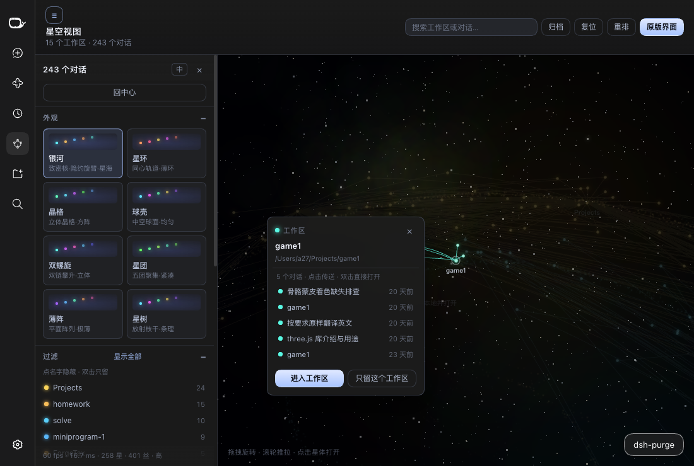
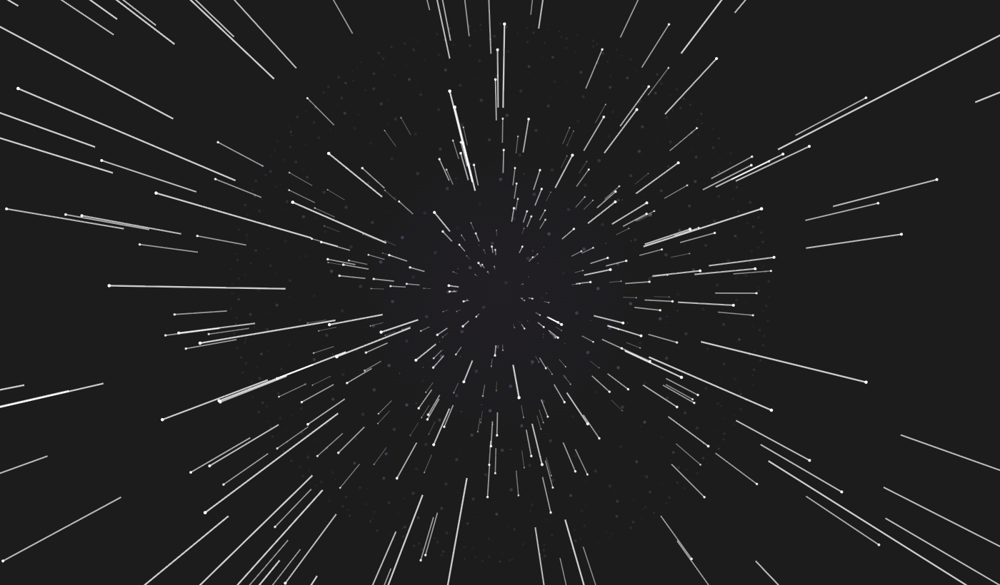

# dsh-graph-view · 星空 / 银河视图

把 DeepSeek Harness 的工作区与对话画成一片**三维星系**，外面罩着一层由硬边白点
组成的空心球壳：工作区是旋臂上的恒星，对话是绕着它们的小巧锐利的星点，
fork/子智能体之间拉出细丝；相机缓慢自转，拖一下就绕轨，滚轮推拉镜头。点一颗星，
画面会跃迁进那条对话或工作区；「回到星系」胶囊再把你送出来。

视觉方向参照 Obsidian 的 [Galaxy View](https://community.obsidian.md/plugins/galaxy-view)
（NASA Eyes 式的电影感 3D 图）：纯黑的深空、清晰的点阵球壳、冷暖相间的小星点、
极细的淡色连线。


## 安装

需要 **DeepSeek Harness Desktop**（含 `main` 面板槽位与 `uiWorkspace` 服务）。
本插件是纯前端 + 一个 host 半包，没有原生依赖。

**从插件市场**（发布后）：搜 `dsh-graph-view`。

**从 npm 装进某个 profile：**

```bash
cd "$DSH_HOME/profiles/web"
pnpm add dsh-graph-view        # 或者：npm install dsh-graph-view
```

`dsh.bundle.patch` 会把插件行插进层栈；重启 Harness（或重开窗口）即可。

**从本仓库本地挂载（开发用）：**

```bash
node scripts/install-into-profile.mjs            # 默认 web profile
node scripts/install-into-profile.mjs --profile "$DSH_PROFILE_DIR"
```

只做两件事：把本包 symlink 进 `<profile>/node_modules/`，
再在 `<profile>/cordis.patch.yml` 末尾插一行 `insert`（改前自动备份，重复执行无副作用）。

装好后打开任意会话，顶栏右侧会出现「星空」按钮；点它进入星系视图，
「原版界面」或星体里的返回胶囊回到对话。想换外观就从左侧面板挑一张预设卡。

## 画面构成

- **星空球壳。** 一个空心球面，铺满致密的**硬边方点**
  （2600 颗 1.2 px、900 颗 2 px、250 颗 3 px，五种低饱和近白色调），
  边缘清晰可读、分布均匀，没有柔光团。每颗颗粒覆盖的像素与同尺寸 WebGL 点完全一致，
  所以镜头环绕时小颗粒会在 1 px 与 2 px 之间跳动，星空像参照实现一样闪烁；画面静止时不闪。壳内还有 780 颗场内浮星，
  让盘面不会显得空。颗粒在屏幕上的尺寸固定，只随「球壳大小」滑杆缩放。
- **星点。** 明亮、不透明的实心圆盘：边缘利落、白热核心（永不削成纯白），
  外加一圈贴边的彩色光晕——总览时对话 4–9 px、工作区 7–16 px，镜头拉近后
  分别可放大到 15 px 和 24 px（随对话数变大）。选中别的星时，其余星点只轻微变暗。没有深色描边，没有塑料感的大光晕。
- **配色。** 默认「深空」主题就是 Galaxy View 的「哈勃深空」配色：青、金、蓝、锈红、
  绿、奶油、紫、粉、银，冷暖交替，奶油和银保持浅淡。和 Galaxy View 一样，对话最多的
  工作区先拿颜色，大工作区之间不会撞色。七套主题（深空、哈勃、霓虹、落日、赛博、矩阵、极光）的底色
  一律是纯黑 `#000000`；颜色只来自星点、连线和世界空间里的星云雾，不再给背景染色。
- **连线。** 明亮细线（约 1.1 CSS 像素，Retina 上 2.2 个设备像素），从一端星点的颜色渐变到另一端；各种颜色按同一亮度绘制，重叠的连线不会叠加变亮；像参照实现一样微微弯离中心。只画真实关系：工作区→对话的归属，
  以及父→子的派生。顶栏的「连线」按键可以显示或隐藏连线；不管开还是关，点击一个对话都只留下它的相关连线。
  控制栏「连线」分区可以调粗细、透明度、弯曲和颜色（跟随星色、预设色块或任意自选色）。
- **构图。** 星点铺满球壳内部而不是挤在中心：螺旋是两条清晰的旋臂加一个稀疏的
  核心；八种布局都摊进同一个体积里，同时保持各自的辨识度。全景取景始终框住
  整个球壳，边缘不会被裁掉。
- **中心无大灯。** 没有中央光球、没有辉光洗白——静止、俯冲、跃迁时都没有。
  中心只有 110 颗减半透明度的微尘。

## 八种布局

预设切换的是整套几何，不只是参数：星体位置、尘埃与淡淡的骨架线都跟随布局。

| 预设 | 形状 | 读法 |
| --- | --- | --- |
| 银河 | `spiral` | 双旋臂盘面，核心稀疏 |
| 星环 | `rings` | 四道同心轨道环，每环一个颜色、不显示连线；所有星体沿各自的环线做双螺旋运动 |
| 浑天 | `sphere` | 浑天仪式的球：5 个**同半径**的圆环，各自倾斜到自己的平面（黄金角分配），合起来就是一个球；星体按体量蛇形分配到各环上均匀占位，每个环在自己的平面内自转 |
| 太阳系 | `system` | 中心是一颗暖色的球状太阳尘埃，每个工作区一颗行星各占一条嵌套轨道，行星外层是一小团球壳状的对话星体；整个系统真的在公转——行星绕太阳（内快外慢），卫星再绕各自行星 |
| 双螺旋 | `helix` | 两条链沿竖直轴攀升，各 1.6 圈；工作区按星体数（自身 + 对话）分配链，两条链星数基本相等，各自贯穿整个高度 |
| 矩阵 | `web` | 一整团绿色星点与直连线，无辉光、无背景 |
| 方阵 | `plate` | 立体正方体：所有星体落在同一套格点上，每个工作区占一块，画出 12 条棱 |
| 星树 | `tree` | 全部由中心点放射：每个工作区一根从原点出发的射线，按黄金角均布在球面上，越重的工作区伸得越远；对话顺着同一条射线向外铺开成一根向末端变粗的管，约三分之一的分叉成细枝 |

| 浑天 | 星环 | 星树 |
| --- | --- | --- |
| *（截图待补）* |  |  |

## 星系怎么读

| 图上 | 含义 |
| --- | --- |
| 带色恒星 | 一个工作区；色相按工作区顺序固定，星点越大对话越多 |
| 恒星周围的星点 | 该工作区下的对话；运行中的会呼吸 |
| 细丝 | 对话的归属关系；fork / 子智能体与父会话之间是更亮的弯丝 |
| 漂浮的星尘 | 旋臂与弥散盘面（「尘埃带」滑杆，默认关闭），纯背景，不可点 |
| 白色硬点球壳 | 星空球壳：真三维的点阵球面，与星系共用同一个摄像机，并且以星系为中心——钻进星体时是**穿过**这层球壳，而不是带着一张背景一起走 |

当前会话有一圈白环；已归档的星点更暗，只在「归档」打开时出现。

## 操作

| 输入 | 结果 |
| --- | --- |
| 拖拽 | 绕轨旋转，带惯性；松手 1.6 秒后恢复自动环绕 |
| 滚轮 | 推拉镜头（每格 `exp(deltaY × 0.0065)`，约 70 ms 跟上，连续滚动会累加，最远可拉到默认视角的约 4.5 倍，四周始终有深空星光） |
| 点击星点 / 恒星 | 镜头俯冲过去（对话落到全景距离的 0.12 倍、980 ms；工作区 0.30 倍、1150 ms），弹出小卡片：标题、路径、时间与状态；它的邻域保持明亮（关联深度 1 或 2 层），其余淡下去，悬停不会压暗 |
| 卡片里的「打开」/「进入工作区」 | 播放跃迁过场，进入那条对话或工作区 |
| 双击星点 / 恒星 | 跳过卡片，直接跃迁 |
| 点击恒星卡片里的某一篇 | 镜头传送过去并选中那颗星（双击该行直接打开） |
| `Tab` / `Shift+Tab` | 在星体之间走，逐个弹出卡片；`Enter` 俯冲或打开当前项 |
| `F` / `R` | 飞向选中的星 / 回到总览 |
| `Esc` | 取消聚焦、选中与正在进行的「连接两篇」 |
| 顶栏搜索框 | 输入标题或路径，选一个结果（方向键 + `Enter`），镜头飞过去；命中项显示名称 |
| harness 侧边栏里的对话 | 星空打开时点它，镜头飞到那颗星，不会退出星空模式（没画出来的对话照常打开） |
| 归档 / 复位 / 重排 | 显示归档 / 回到默认机位 / 换一套随机种子重新成盘 |
| ☰ | 收起 / 展开左侧控制栏；拖动它的右边缘调整宽度（240–480 px） |



**跃迁。** 进入一颗星时，先在真实场景里向它俯冲，随后一圈细点加速拉成
1 px 的光带，最后收成该星颜色的空心灵巧球壳——硬边方点从中心向外波纹式亮起，
光晕同步脉冲。覆盖层会等目标面板挂载完成才淡出；主线程卡顿只会推迟各阶段，
不会跳过。进入工作区或对话后，落地球壳留在屏幕上当你此刻所在的房间：同一个球面，
但整球放大到帧外（看不到球缘），每颗方点大小一致、亮度一致，分两层缓慢反向旋转，
外加一圈星体颜色的内壁光晕和「回到星系」胶囊（点它播放一段短暂的反向跃迁）。
开启「减弱动态效果」时，飞行改为淡入淡出。



进入星空视图时，harness 的左侧导航栏会自动收起（给星系整窗宽度）；离开时按
原来的宽度还原。如果你在星空里手动把导航栏拉回来了，退出时不会被再次收起。

## 记忆库

顶栏的 **记忆库** 按钮把星系换成另一张图：塑造智能体行为的指令文件、能加载的技能，
以及每个技能到底被调用过多少次。两个视图挂在同一个面板后面，选择会被记住。

| 画面 | 含义 |
| --- | --- |
| 内核里的金色星体 | 一份指令文件：`AGENTS.md`、`CLAUDE.md`、`prompt-inject.md`、`rules/*.md`、工作区 `README.md` |
| 旋臂上的青色星体 | 一个技能；色相表示来源（自有 / 共享 `~/.agents` / 项目 / 随包），大小随调用次数增长 |
| 绕着技能的小星 | 一次调用：某个会话加载了它；超过 16 次只计数，不再画点 |
| 细线 | 调用 → 它加载的那个技能 |

点星体或左侧列表的一行即可选中；列表下方的卡片说明它是什么、放在哪儿，**打开** 会把
文件读进右侧编辑器。编辑器直接写回磁盘：`⌘S` / `Ctrl+S` 保存，打开之后被别处改过的文件
会以冲突返回（*重新加载* 或 *覆盖保存*），随应用发布的文件保持只读。拖动环绕、滚轮缩放、
双击空白复位、双击星体打开。

Node 端自己找齐这个库 —— DSH home、`~/.agents`、各工作区的 `.dsh/skills` 与
`.agents/skills`、vendor 与扩展目录，再加上宿主技能注册表知道的部分 —— 并从每个会话日志
里读回技能调用（普通 `.jsonl` 和逐帧追加的 `.zstd` 一样处理）。它在宿主的 web 服务上提供
一条带鉴权的 RPC 通道 `/dsh-graph-view`，浏览器端只看得到 discovery 认过的路径。
细节见 [docs/memory-library.md](docs/memory-library.md)。

给已经开着的 DSH 加上这个视图需要重启：Node 端跟随宿主进程挂载，不跟页面走。

## 控制栏

点标题栏的 ☰ 收起，其余时候它一直贴在左侧，可滚动。控制栏顶部有语言切换
（跟随 / 中 / EN）和一个 **?** 帮助卡（快捷键与过滤语法）。各分区的展开状态会被记住。

| 分区 | 里边有什么 |
| --- | --- |
| 外观 | 八张预设卡——每个预设是一整套参数（主题、辉光、深空背景、球壳、旋臂形态、连线弯曲、眨眼、环绕速度）；鼠标悬停立刻预览，点击则用 560ms 溶解过渡：旧画面淡出、新星体从核心长出 |
| 过滤 | 每个工作区一行，带色点与对话数；单击隐藏，双击只留它；孤星、空工作区可单独放出；过滤框沿用 Galaxy View 的语法（空格分隔＝同时满足，`-词` 排除，`path:` / `name:` 限定字段，`"短语"`） |
| 状态 | 全部 / 运行中 / 当前 / 子智能体 / 已归档 五种透镜，非命中项压暗但仍可点 |
| 外观与配色 | 七套主题、洗牌配色、节点大小、星星眨眼，以及大小依据（活跃度 / 链接数 / 统一） |
| 连线 | 显示连线开关（与顶栏按键同步；关闭时点击对话仍显示它的相关连线）、连线粗细（0.2–4 倍）、链接透明度、连线亮度（0.3–2.5，大于 1 提亮、小于 1 压暗，保持色相）、连线弯曲（0 直线到 2）、颜色：跟随星色、四个色块或取色器 |
| 深空背景 | 星云天幕、空间浮星、集群云雾、尘埃带、球壳密度、球壳大小、球壳亮度，以及星空背景开关 |
| 辉光 | 星体亮度、辉光强度、辉光范围、阈值 |
| 形态 | 旋臂数、缠绕、厚度、散布，直接重解星系几何 |
| 力学 | 斥力、链接距离、链接强度、向心力、扁平度、核心引力、旋涡——叠在布局上的实时力导向层 |
| 导航与动效 | 自动环绕开关 ＋ 速度、巡游及巡游速度、关联深度（1 或 2 层）、**连接两篇**（点选两颗星，镜头沿最短链接路径逐跳飞过去；两颗星不在同一工作区时经由各自的工作区）、重播开场动画、全部重置、存为我的预设（最多 8 个；双击改名，↑ 调整顺序，× 删除前会确认） |
| 高级 | 质量 自动 / 高 / 低 / 移动（移动档关闭辉光与云雾，最多绘制 1500 颗星），底部一行实时 `fps · ms · 星数 · 丝数 · 质量` |

每条滑杆上都有一个默认值刻度（当前预设拥有的参数取预设值）；双击滑杆或滑杆名即可回到默认。
每个分区标题会注明「由『某预设』设定」，改动后显示「已自定义」，并提供只还原这一分区的「↺ 还原」。

自动环绕按 Galaxy View 的巡航速度（约 5 分钟一圈），控制栏里 0.2×–3× 可调；鼠标停在星点上时
环绕会暂停，不会从指针底下溜走。所有设置都写进 `localStorage`。

**设置迁移。** 画面改动大到旧的外观设置会把新效果盖住，所以设置带上了版本号
（现为 3）。升级后首次加载时，外观项（预设、布局、主题、各滑杆、形态、力学、
环绕速度、质量）会一次性重置为新默认值。你的筛选全部保留：隐藏的工作区、
「只留它」、过滤文本、状态透镜、孤星与空工作区开关、自动环绕与巡游开关，
以及语言、控制栏宽度与分区展开状态、关联深度。

## 开发

```bash
npm run check     # build（同时做语法门禁）+ selfcheck
```

- `src/settings.js` — 纯外观数据：预设、主题、默认值与设置版本迁移。
  不碰 DOM，selfcheck 直接 import 它。
- `src/graph-model.js` — 纯函数：工作区/会话 → 星体与连线、八种布局
  （`placeFolder` / `placeDust` / `layoutGuides`）、球壳、场内浮星与空间浮星颗粒集、
  过滤语法、移动档节点上限、最短路径、相机基与透视投影。确定性：一个 FNV-1a 哈希
  经 murmur3 收尾派生出所有随机流。
- `src/gpu.js` — 手写 WebGL2 `POINTS` 通道：全体星体一次绘制、全体光晕再一次绘制（约 200 行，无 three.js 依赖），失败即回落到 Canvas 2D。
- `src/memory.js` — 纯函数：记忆库的图（指令文件、技能、调用记录）与它的环/臂布局。
- `src/physics.js` — 纯函数：七条力学滑杆背后的力导向层，锚定在解析布局上，
  默认参数下收敛回布局本身。
- `src/stars.js` — Galaxy View 星体配方在 Canvas 2D 上的翻译：圆盘轮廓、
  平台色、光晕透明度、连线调色，以及全部缓存好的精灵烘焙器。
- `src/client.js` — React + Canvas 2D：渲染循环（星云雾 → 球壳 → 星尘 →
  骨架 → 连线 → 星点 → 标签）、指针交互、俯冲补间与控制栏。
- `src/warp.js` — 进入星体的过场覆盖层。
- `src/styles.css` — 面板 UI、星体内壁光晕与返回胶囊。
- `scripts/build.mjs` — 把各源码内联进 `lib/client.js`，包一层
  `window.__ModuleLoader__.load({ id, factory })`，不依赖任何打包器，
  并对产物做 `node --check` 门禁。
- `scripts/selfcheck.mjs` — 几何、相机、迁移、双语对照、打包与产物锁
  （4410 颗螺旋星尘、TDZ 顺序、main 槽位不得声明 `children`……）。

### 渲染要点

- **球壳颗粒**是硬边方点，覆盖的设备像素与同尺寸 WebGL 点一致（像素中心落在 `size/2` 内），CSS 尺寸固定（1.2 / 2 / 3 px ×
  球壳大小），按桶合批一次画完，低饱和色调；每帧不分配对象、不建渐变。
- **星体**是按实际设备尺寸、4×4 超采样烘焙的缓存圆盘精灵：边缘平台饱和度
  0.7、亮度 0.66（红橙色更深、更饱和）、峰值通道封顶 240，实心到半径 0.9，白色混合从
  中心按 `0.75·(1 − r/rd)^2.4` 衰减（像自发光的球体，而不是扁平的珠子），外加两圈固定屏幕尺寸的光晕（σ 3 px 与 σ 10 px，内圈透明度
  `0.6·min(1, (r/3)²)`）。
- **连线**用 `source-over`、一个设备像素（Retina 上 1.5 个，免得看不见）；控制点取世界中点沿其相对
  原点的方向推出 `0.32 × 弯曲 × 边长`（归属）或 `0.18 × 弯曲`（派生；
  「连线弯曲」默认 0.35，0 为直线），靠近原点时退化为水平垂直方向；颜色是带一点
  两端混色、饱和度 `s × 0.4`（同参照实现）的亮线（`l 0.76`），链接透明度 0.14 时 alpha 0.85（派生 0.95），随滑杆缩放；
  每个预设带 Galaxy View 对应的链接透明度（0.07–0.28）。
- **星尘**在螺旋上恰好 4410 颗（3200 沿旋臂、1100 弥散盘面、110 颗核心微尘）；
  其余布局按自身体积铺尘，并先平移到星体质心。
- **相机**：全景距离 = `fitDistance(球壳半径, fov) × 0.86`，
  球壳半径 = `extent × 1.22`；回中心与复位的取景一致，球壳边缘始终完整在画面里。
- **质量档**：低档画 1/3 星尘、1/2 星点、DPR 1；中档一半星尘、DPR 2；高档全量。
  自动档在帧耗时高于 19 ms 时降档、低于 14.5 ms 时升档，1.5 s 内不反复切。
  面板底部的 `ms` 才是真正的余量（fps 会被屏幕刷新率封顶）。

零运行时依赖：只用 loader 提供的 `react` 和既有的 `ctx.slots / ctx.locale /
ctx.sessions / ctx.workspaces / ctx.uiWorkspace / ctx.layout`。

## 与 Galaxy View 的差别（有意为之）

- 这里的节点是**工作区 / 会话**，不是笔记文件；连线是归属与派生，不是 `[[链接]]`。
- 布局先是**解析式**的（按布局直接放置 + 抖动，同数据永远同样子）。「力学」
  七条滑杆驱动一层主线程上的力导向，锚定在这个布局上：默认参数保持预设的轮廓，
  每条滑杆从那里把它推弯；每帧约 4 ms 预算内步进，收敛后休眠。「形态」四条
  滑杆仍然是重解一次盘面。
- 控制栏的分区对齐了 Galaxy View，但调的是「工作区 / 对话」这套数据：会话没有
  tag，「标签」换成状态透镜；也没有未解析链接、幽灵节点和 2D 图谱导入。
- 每个工作区是一个独立的连通块（对话只连到自己的工作区），所以跨工作区的
  「连接两篇」会经由两边的恒星飞过去。
- 星体外观沿用参照配方——软边圆盘 + 白热核心 + 固定光晕——但用缓存的
  Canvas 2D 精灵重建，而不是 three.js 的点 shader。三个辉光滑杆分工固定：
  亮度只动星体本身（连线走「连线亮度」），强度动光晕整体，范围动光晕的尺寸
  （同时按面积补偿亮度，否则放大只会变淡），阈值按每颗星自己的「大小依据」质量
  决定它到底发不发光，越往右只剩最大的恒星。

## 发布

包已按 DSH 社区市场的要求备好；发布本身手动执行。按顺序：

1. 建公开仓库 `dialling/dsh-graph-view`，推送 `main`。
2. 给仓库加上 GitHub topic `dsh-plugin`。
3. `npm login`，然后 `npm publish`（`prepack` 会先重新构建并自检）。
4. 可选：打一个 `v0.3.0` 的 GitHub Release。
5. 仓库满一天后，向 `awesome-dsh-plugin/awesome-dsh-plugin` 提市场收录 PR。

完整清单、可直接粘贴的市场条目、以及测试市场安装前如何移除本地开发挂载，
都写在 [PUBLISHING.md](PUBLISHING.md) 里。

## License

MIT
