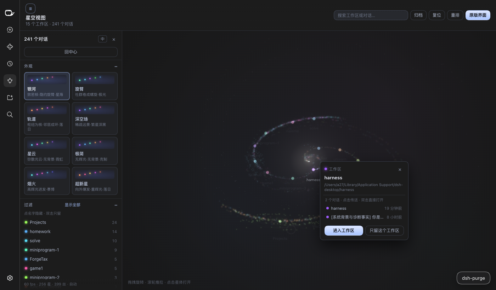

# dsh-graph-view · 星空 / 银河视图

把 DeepSeek Harness 的工作区与对话画成一片**三维星系**：工作区是旋臂上带光晕的恒星，
对话是绕着它们旋绕的星点，fork/子智能体之间拉出细丝；相机在缓慢自转，
拖一下就绕轨，滚轮推拉镜头。点一颗星回到那条对话，点「原版界面」回到 Harness 原本的样子。

视觉方向参照 Obsidian 的 [Galaxy View](https://community.obsidian.md/plugins/galaxy-view)
（NASA Eyes 式的电影感 3D 图）：深空底、发光星体、去饱和的连线、缓慢旋转的星场。



## 与原版界面的关系

- 原版界面**一处未改**：三栏框架、会话列表、对话渲染都是原组件。
- 侧栏面板栏多一行 **星空图谱**（和「插件」同层），打开即进入星系，是一个 `main` 面板。
- 对话顶栏多一个 **星空** 按钮（`标准模式` 旁边），随手切换。
- 星系页右上 **原版界面** = `layout.selectPanel(null)`，回到原来的对话视图。

## 星系怎么读

| 图上 | 含义 |
| --- | --- |
| 带色晕的恒星 | 一个工作区；色相按工作区顺序固定，光晕越大对话越多 |
| 恒星周围的星点 | 该工作区下的对话；越新越亮越大，运行中的会呼吸 |
| 白色细丝 | 对话的归属关系；fork / 子智能体与父会话之间是更亮的弯丝 |
| 中心白色光点 | 星系核：一颗小亮核（半径 16–40 px）加一层薄光晕，旋臂在这里汇合；刻意压小，不再是一颗占满中心的白球 |
| 旋转的星尘 | 旋臂、盘面弥散星，纯背景，不可点 |
| 包住整个星系的白色小球 | 「星空球壳」：真三维的球面点阵，跟星系共用同一个摄像机。每颗是缓存好的径向 sprite，纯白偏冷，近大远小 |
| 星点 = 带色光点 | 对话/工作区仍是**带色相的 ~1 px 光核 + 柔和光晕**（工作区有 1.8–4.2 px 的实心核），靠色相和光晕和灰白球壳区分；球壳颗粒比上一版缩小约 35% |

底色取 Obsidian 深色主题的 `--color-base-00: #1C1C1C`（面板、顶栏、画布同一块黑），
所以切过来不会觉得像另一个 App 的深蓝夜空。

盘面以外（星环/晶格/球壳/双螺旋/星团/薄阵/星树）不吃这套柔光：球壳颗粒改成 1 px 级硬边方点（光晕倍率 1.7 → 1.15），尘埃尺寸封顶 2.7 px，星点改成 2–7 px 的**实心色球 + 深色描边**，命中半径放宽到 16 px —— 这几项是为了在点云里能看清、也点得到每一颗。盘面（银河）保持原来的 1–2 px 彩芯 + 柔光。
星点默认是 1–2 px 的彩色硬芯 + 一层很淡的光晕，密集处也不会糊成白团；
亮度、光晕范围、阈值都可以在控制栏里调，默认值偏克制（亮度 0.5）；
滚轮灵敏度已提高约 2.5 倍（`exp(deltaY × 0.0028)`，一格约 32%），推拉范围 0.26–7；镜头贴近时球壳自动淡到 22%（`clamp(distance/1.9, 0.22, 1)`），不抢前景。
球壳亮度基线（2600/900/250 三档的 alpha 0.68/0.78/0.92、尺寸 0.0042/0.0072/0.0112）已经调亮过一轮；贴近镜头时的自动减弱改为 `clamp(distance/1.9, 0.5, 1)`，追踪时只收到 78%，不会像之前那样掉到 22%。
球壳有三个滑杆：**球壳密度**（同时决定数量与过滤步长）、**球壳大小**（0.4–2.4 倍）、**球壳亮度**（0–2 倍）。密度拉到 0 就只剩星系本身。
球面半径固定在世界坐标（`1.16`）× `shellScale`，`shellScale = extent × 1.22 / 1.16`，不跟相机距离走，所以推近镜头时球壳是**变大地涌过来**，不会钉在屏幕上。
取景按**球壳**算而不是按星体算（`fit = fitDistance(shellRadius) × 0.86`），所以球壳的圆边始终在画面里留着余量，星体坐在球壳中间而不是被一层满屏白雾包住。
非盘面布局（晶格/球壳/星团/薄阵/星树）会先把自身质心平移到原点再画——六个枝干、五个球团、3×3×3 空格子都不对称，不平移就会偏到球壳一边。螺旋保持以星核为原点，平移会把双旋臂压成半个。
面板底部显示 `fps · ms`：fps 会被屏幕刷新率封顶（60 Hz 就是 60），`ms` 才是真正的余量；质量档按实测帧耗时自适应（>19 ms 降档、<14.5 ms 升档，1.5 s 内不反复切）。

当前会话有一圈白环；已归档的星点更暗，只在「归档」打开时出现。

筛选（「只留它」/隐藏/镜头/搜索）如果把所有星体都筛掉，画面不再假装"没有数据"：会写明"筛选后没有星体"并给一个「清除筛选」按钮。另外，被「只留它」钉住又被隐藏的工作区，下次加载会自动解除钉住并取消隐藏——那种组合只会得到一个空星空。

## 外观预设：八种几何

## 操作

| 输入 | 结果 |
| --- | --- |
| 拖拽 | 绕轨旋转，带惯性；松手 1.6 秒后恢复自动环绕 |
| 滚轮 | 推拉镜头（0.8–7 倍） |
| 点击星点 / 恒星 | 弹出小卡片：标题、路径、时间与状态，底部是「打开」/「进入工作区」 |
| 卡片里的「打开」 | 先播「进入星体」过场：四周白色点阵加速拉成光带 → 收成该星颜色的空星球壳 → 对话在球心升起 |
| 卡片里的「打开」 | 打开那条对话，图层切回对话视图 |
| 双击星点 / 恒星 | 跳过卡片，直接打开 |
| 点击恒星卡片里的某一篇 | 镜头传送过去并选中那颗星（双击该行直接打开） |
| `Tab` / `Shift+Tab` | 在星体之间走，逐个弹出卡片；`Enter` 打开当前卡片 |
| 搜索框 | 按标题、路径过滤，命中项描边并显示名称 |
| 归档 / 复位 / 重排 | 显示归档 / 回到默认机位 / 换一套随机种子重新成盘 |
| ☰ | 收起 / 展开左侧控制栏 |

进入星空视图时，harness 的左侧导航栏会自动收起（给星系整窗宽度）；点「原版界面」或点星点进入对话时再按你原来的宽度还原。如果你在星空里手动把导航栏拉回来了，退出时不会被再次收起。
| `Esc` | 取消聚焦与选中 |

自动环绕默认很慢（约 15 分钟一圈），控制栏里 0.2×–3× 可调；鼠标停在星点上时
环绕会暂停，不会从指针底下溜走。

## 控制栏

点标题栏的 ☰ 收起，其余时候它一直贴在左侧，可滚动，分区与 Galaxy View 对齐：

| 分区 | 里边有什么 |
| --- | --- |
| 外观 | 8 个预设：银河、旋臂、轨道、深空场、星云、极简、烟火、超新星。每个预设是一整套参数（配色、辉光、深空背景、旋臂形态、环绕速度），点一下整套切换 |
| 过滤 | 每个工作区一行，带色点与对话数；单击隐藏，双击只看它；孤星（没有工作区归属的对话）、空工作区可单独放出；还有按名字过滤 |
| 状态 | 全部 / 运行中 / 当前 / 子智能体 / 已归档 五种透镜，非命中项压暗但仍可点 |
| 外观与配色 | 哈勃、霓虹、落日、赛博、矩阵、极光 六套色相 ＋ 改变后显示「已自定义 / 还原」 |
| 深空背景 | 星云天幕、空间浮星、集群云雾 三条滑杆 ＋ 星空背景开关 |
| 辉光 | 强度、范围、阈值 三条滑杆；双击滑杆名恢复预设值 |
| 形态 | 旋臂数、缠绕、厚度、散布，直接重解星系几何 |
| 导航与动效 | 自动环绕开关 ＋ 速度、巡游（自动漫游到最近活跃的对话）、重播开场动画、全部重置、存为我的预设（最多 8 个，存 localStorage）、我的预设列表 |
| 高级 | 质量 自动/高/低（低档减少星尘与浮星、降 DPR），底部一行实时 `fps · 星数 · 丝数 · 质量` |

所有设置都写进 `localStorage`，刷新或重开面板都还在。

## 安装

**从插件市场**（发布后）：搜 `dsh-graph-view`。

**装进某个 profile：**

```bash
cd "$DSH_HOME/profiles/web"
pnpm add dsh-graph-view
```

`package.json` 的 `dsh.bundle.patch` 会把插件行插进层栈；重启 Harness（或重开窗口）即可。

**从本仓库本地挂载（开发用）：**

```bash
node scripts/install-into-profile.mjs            # 默认 web profile
node scripts/install-into-profile.mjs --profile "$DSH_PROFILE_DIR"
```

只做两件事：把本包 symlink 进 `<profile>/node_modules/`，
再在 `<profile>/cordis.patch.yml` 末尾插一行 `insert`（改前自动备份，重复执行无副作用）。

## 开发

```bash
npm run check     # build（同时做语法门禁）+ selfcheck
```

- `src/graph-model.js` — 纯函数：工作区/会话 → 星体与连线、旋臂播种、相机基与透视投影、取景、邻居表。
  Node 里可直接跑，`scripts/selfcheck.mjs` 就是这样验的（确定性、盘面厚度、全星体在相机前方、取景命中）。
- `src/client.js` — React + Canvas 2D：辉光精灵、星云背景烘焙、指针交互、提示气泡。相加混合
  （`globalCompositeOperation = "lighter"`）在没有后处理的画布上做出 bloom。
- `src/styles.css` — 两套：顶栏按钮跟随主题 token，星系页固定深空。
- `scripts/build.mjs` — 把三份源码包进 `window.__ModuleLoader__.load({ id, factory })`，
  不依赖任何打包器，并对产物做 `node --check`（重复 `const` 这类致命错误会直接终止构建）。

零运行时依赖：只用 loader 提供的 `react` 和既有的 `ctx.slots / ctx.locale / ctx.sessions /
ctx.workspaces / ctx.uiWorkspace / ctx.layout`。

## 与 Galaxy View 的差别（有意为之）

- 这里的节点是**工作区 / 会话**，不是笔记文件；连线是归属与派生出，不是 `[[链接]]`。
- 布局是**解析式**的（旋臂 + 抖动，同数据永远同样子），不跑力导向、不进 Worker，
  换工作区不会"跳盘"。控制栏里的「形态」四条滑杆改的是解析参数（旋臂数、缠绕、厚度、散布），
  不是物理引擎，所以拖动时是"重解一次盘面"，而不是 Galaxy View 的连续物理回弹。
- 控制栏的**分区与滑杆对齐了 Galaxy View**（预设、过滤、状态透镜、配色、深空背景、辉光、形态、
  导航动效、高级、统计），但它调的是「工作区 / 对话」这套数据：预设换了配色与形态，
  「标签」换成了状态透镜（会话没有 tag），「连接两篇」没有对应概念，改成「巡游」。
- bloom 是 Canvas 2D 的相加辉光精灵，不是后处理管线；所以「阈值」调的是辉光与硬芯的比例，
  而不是真正的亮度阈值。
- 固定深空（不跟随浅色主题）：这是「星空」本身。

## 发布

```bash
npm run prepack      # build + selfcheck
npm publish
```

`dsh.bundle.patch`、`dsh.client`、`files`、`keywords`、`repository` 已备好；
`locale/{zh,en}.json` 提供市场卡片文案。

## License

MIT

当前会话有一圈白环；已归档的星点更暗，只在「归档」打开时出现。

筛选（「只留它」/隐藏/镜头/搜索）如果把所有星体都筛掉，画面不再假装"没有数据"：会写明"筛选后没有星体"并给一个「清除筛选」按钮。另外，被「只留它」钉住又被隐藏的工作区，下次加载会自动解除钉住并取消隐藏——那种组合只会得到一个空星空。

## 操作

| 输入 | 结果 |
| --- | --- |
| 拖拽 | 绕轨旋转，带惯性；松手 1.6 秒后恢复自动环绕 |
| 滚轮 | 推拉镜头（0.8–7 倍） |
| 点击星点 / 恒星 | 弹出小卡片：标题、路径、时间与状态，底部是「打开」/「进入工作区」 |
| 卡片里的「打开」 | 先播「进入星体」过场：四周白色点阵加速拉成光带 → 收成该星颜色的空星球壳 → 对话在球心升起 |
| 卡片里的「打开」 | 打开那条对话，图层切回对话视图 |
| 双击星点 / 恒星 | 跳过卡片，直接打开 |
| 点击恒星卡片里的某一篇 | 镜头传送过去并选中那颗星（双击该行直接打开） |
| `Tab` / `Shift+Tab` | 在星体之间走，逐个弹出卡片；`Enter` 打开当前卡片 |
| 搜索框 | 按标题、路径过滤，命中项描边并显示名称 |
| 归档 / 复位 / 重排 | 显示归档 / 回到默认机位 / 换一套随机种子重新成盘 |
| ☰ | 收起 / 展开左侧控制栏 |

进入星空视图时，harness 的左侧导航栏会自动收起（给星系整窗宽度）；点「原版界面」或点星点进入对话时再按你原来的宽度还原。如果你在星空里手动把导航栏拉回来了，退出时不会被再次收起。
| `Esc` | 取消聚焦与选中 |

自动环绕默认很慢（约 15 分钟一圈），控制栏里 0.2×–3× 可调；鼠标停在星点上时
环绕会暂停，不会从指针底下溜走。

## 控制栏

点标题栏的 ☰ 收起，其余时候它一直贴在左侧，可滚动，分区与 Galaxy View 对齐：

| 分区 | 里边有什么 |
| --- | --- |
| 外观 | 8 个预设：银河、旋臂、轨道、深空场、星云、极简、烟火、超新星。每个预设是一整套参数（配色、辉光、深空背景、旋臂形态、环绕速度），点一下整套切换 |
| 过滤 | 每个工作区一行，带色点与对话数；单击隐藏，双击只看它；孤星（没有工作区归属的对话）、空工作区可单独放出；还有按名字过滤 |
| 状态 | 全部 / 运行中 / 当前 / 子智能体 / 已归档 五种透镜，非命中项压暗但仍可点 |
| 外观与配色 | 哈勃、霓虹、落日、赛博、矩阵、极光 六套色相 ＋ 改变后显示「已自定义 / 还原」 |
| 深空背景 | 星云天幕、空间浮星、集群云雾 三条滑杆 ＋ 星空背景开关 |
| 辉光 | 强度、范围、阈值 三条滑杆；双击滑杆名恢复预设值 |
| 形态 | 旋臂数、缠绕、厚度、散布，直接重解星系几何 |
| 导航与动效 | 自动环绕开关 ＋ 速度、巡游（自动漫游到最近活跃的对话）、重播开场动画、全部重置、存为我的预设（最多 8 个，存 localStorage）、我的预设列表 |
| 高级 | 质量 自动/高/低（低档减少星尘与浮星、降 DPR），底部一行实时 `fps · 星数 · 丝数 · 质量` |

所有设置都写进 `localStorage`，刷新或重开面板都还在。

## 安装

**从插件市场**（发布后）：搜 `dsh-graph-view`。

**装进某个 profile：**

```bash
cd "$DSH_HOME/profiles/web"
pnpm add dsh-graph-view
```

`package.json` 的 `dsh.bundle.patch` 会把插件行插进层栈；重启 Harness（或重开窗口）即可。

**从本仓库本地挂载（开发用）：**

```bash
node scripts/install-into-profile.mjs            # 默认 web profile
node scripts/install-into-profile.mjs --profile "$DSH_PROFILE_DIR"
```

只做两件事：把本包 symlink 进 `<profile>/node_modules/`，
再在 `<profile>/cordis.patch.yml` 末尾插一行 `insert`（改前自动备份，重复执行无副作用）。

## 开发

```bash
npm run check     # build（同时做语法门禁）+ selfcheck
```

- `src/graph-model.js` — 纯函数：工作区/会话 → 星体与连线、旋臂播种、相机基与透视投影、取景、邻居表。
  Node 里可直接跑，`scripts/selfcheck.mjs` 就是这样验的（确定性、盘面厚度、全星体在相机前方、取景命中）。
- `src/client.js` — React + Canvas 2D：辉光精灵、星云背景烘焙、指针交互、提示气泡。相加混合
  （`globalCompositeOperation = "lighter"`）在没有后处理的画布上做出 bloom。
- `src/styles.css` — 两套：顶栏按钮跟随主题 token，星系页固定深空。
- `scripts/build.mjs` — 把三份源码包进 `window.__ModuleLoader__.load({ id, factory })`，
  不依赖任何打包器，并对产物做 `node --check`（重复 `const` 这类致命错误会直接终止构建）。

零运行时依赖：只用 loader 提供的 `react` 和既有的 `ctx.slots / ctx.locale / ctx.sessions /
ctx.workspaces / ctx.uiWorkspace / ctx.layout`。

## 与 Galaxy View 的差别（有意为之）

- 这里的节点是**工作区 / 会话**，不是笔记文件；连线是归属与派生出，不是 `[[链接]]`。
- 布局是**解析式**的（旋臂 + 抖动，同数据永远同样子），不跑力导向、不进 Worker，
  换工作区不会"跳盘"。控制栏里的「形态」四条滑杆改的是解析参数（旋臂数、缠绕、厚度、散布），
  不是物理引擎，所以拖动时是"重解一次盘面"，而不是 Galaxy View 的连续物理回弹。
- 控制栏的**分区与滑杆对齐了 Galaxy View**（预设、过滤、状态透镜、配色、深空背景、辉光、形态、
  导航动效、高级、统计），但它调的是「工作区 / 对话」这套数据：预设换了配色与形态，
  「标签」换成了状态透镜（会话没有 tag），「连接两篇」没有对应概念，改成「巡游」。
- bloom 是 Canvas 2D 的相加辉光精灵，不是后处理管线；所以「阈值」调的是辉光与硬芯的比例，
  而不是真正的亮度阈值。
- 固定深空（不跟随浅色主题）：这是「星空」本身。

## 发布

```bash
npm run prepack      # build + selfcheck
npm publish
```

`dsh.bundle.patch`、`dsh.client`、`files`、`keywords`、`repository` 已备好；
`locale/{zh,en}.json` 提供市场卡片文案。

## License

MIT

| 预设 | 形状 | 读法 |
| --- | --- | --- |
| 银河 | `spiral` | 双旋臂盘面（Obsidian 星系视图那个） |
| 星环 | `rings` | 四道同心轨道环，无旋臂，几乎全平 |
| 晶格 | `lattice` | 3×3×3 立体方阵 + 十字格点标记 |
| 球壳 | `bubble` | 中空球面，三层大圆骨架 |
| 双螺旋 | `helix` | 两条链沿竖直轴攀升，各 1.6 圈 |
| 星团 | `clusters` | 五个紧凑球团绕核分布 |
| 薄阵 | `plate` | 平面方格，纵厚压到 0.02 |
| 星树 | `tree` | 六条放射枝干，逐层变远 |

每个预设不只是换参数，而是换 `layout`：星体的位置由 `placeFolder(layout, …)` 直接给出，尘埃由 `placeDust(layout, …)` 按同一形状铺满体积（晶格是立方体积、球壳是球面、星环是四道环），骨架线由 `layoutGuides(layout)` 给出。所以它们不是"同一个螺旋的八种参数"，是八种几何。

