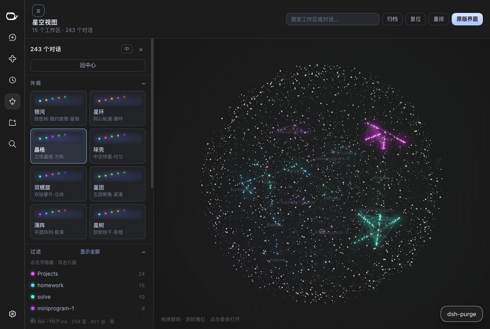

# dsh-graph-view · 星空 / 银河视图

把 DeepSeek Harness 的工作区与对话画成一片**三维星系**，外面罩着一层由硬边白点
组成的空心球壳：工作区是旋臂上的恒星，对话是绕着它们的小巧锐利的星点，
fork/子智能体之间拉出细丝；相机缓慢自转，拖一下就绕轨，滚轮推拉镜头。点一颗星，
画面会跃迁进那条对话或工作区；「回到星系」胶囊再把你送出来。

视觉方向参照 Obsidian 的 [Galaxy View](https://community.obsidian.md/plugins/galaxy-view)
（NASA Eyes 式的电影感 3D 图）：近黑的深空、清晰的点阵球壳、冷暖相间的小星点、
极细极淡的连线。


## 画面构成

- **星空球壳。** 一个空心球面，铺满致密的**像素对齐硬边方点**
  （2600 颗 1.2 px、900 颗 2 px、250 颗 3 px，五种低饱和近白色调），
  边缘清晰可读、分布均匀，没有柔光团。壳内还有 780 颗场内浮星，
  让盘面不会显得空。颗粒在屏幕上的尺寸固定，只随「球壳大小」滑杆缩放。
- **星点。** 小而锐利的实心圆盘：软边、白热核心（永不削成纯白）、中等饱和度，
  外加一圈固定像素的小光晕——对话 2–5 px，工作区 2.4–4.6 px，
  再密集也不会糊成白团。没有深色描边，没有塑料感的大光晕。
- **配色。** 默认「深空」主题按工作区顺序交替冷色（青、蓝白）与暖色（金、橙），
  两条旋臂上冷暖各半。底色是近黑的 `#000003`；其余六套主题
  （哈勃、霓虹、落日、赛博、矩阵、极光）保留各自配色与经典的 `#1c1c1c` 底色。
- **连线。** 极细（一个设备像素）、极淡的丝线，颜色取两端星点混色后去饱和、
  压暗；像参照实现一样微微弯离中心。只画真实关系：工作区→对话的归属，
  以及父→子的派生。
- **构图。** 星点铺满球壳内部而不是挤在中心：螺旋是两条清晰的旋臂加一个稀疏的
  核心；八种布局都摊进同一个体积里，同时保持各自的辨识度。全景取景始终框住
  整个球壳，边缘不会被裁掉。
- **中心无大灯。** 没有中央光球、没有辉光洗白——静止、俯冲、跃迁时都没有。
  中心只有 110 颗减半透明度的微尘。

## 八种布局

预设切换的是整套几何，不只是参数：星体位置、尘埃与淡淡的骨架线都跟随布局。

| 预设 | 形状 | 读法 |
| --- | --- | --- |
| 银河 | `spiral` | 双旋臂盘面，核心稀疏 |
| 星环 | `rings` | 四道同心轨道环，几乎全平 |
| 晶格 | `lattice` | 3×3×3 立体方阵 + 十字格点标记 |
| 球壳 | `bubble` | 中空球面，三层大圆骨架 |
| 双螺旋 | `helix` | 两条链沿竖直轴攀升，各 1.6 圈 |
| 星团 | `clusters` | 五个紧凑球团绕核分布 |
| 薄阵 | `plate` | 平面方格，纵厚压到 0.02 |
| 星树 | `tree` | 六条放射枝干，逐层变远 |

| 晶格 | 星环 | 星树 |
| --- | --- | --- |
|  |  |  |

## 星系怎么读

| 图上 | 含义 |
| --- | --- |
| 带色恒星 | 一个工作区；色相按工作区顺序固定，星点越大对话越多 |
| 恒星周围的星点 | 该工作区下的对话；运行中的会呼吸 |
| 细丝 | 对话的归属关系；fork / 子智能体与父会话之间是更亮的弯丝 |
| 漂浮的星尘 | 旋臂与弥散盘面，纯背景，不可点 |
| 白色硬点球壳 | 星空球壳：真三维的点阵球面，与星系共用同一个摄像机 |

当前会话有一圈白环；已归档的星点更暗，只在「归档」打开时出现。

## 操作

| 输入 | 结果 |
| --- | --- |
| 拖拽 | 绕轨旋转，带惯性；松手 1.6 秒后恢复自动环绕 |
| 滚轮 | 推拉镜头（每格 `exp(deltaY × 0.0028)`，范围 0.26–7 倍） |
| 点击星点 / 恒星 | 镜头俯冲过去（对话落到全景距离的 0.12 倍、980 ms；工作区 0.30 倍、1150 ms），弹出小卡片：标题、路径、时间与状态 |
| 卡片里的「打开」/「进入工作区」 | 播放跃迁过场，进入那条对话或工作区 |
| 双击星点 / 恒星 | 跳过卡片，直接跃迁 |
| 点击恒星卡片里的某一篇 | 镜头传送过去并选中那颗星（双击该行直接打开） |
| `Tab` / `Shift+Tab` | 在星体之间走，逐个弹出卡片；`Enter` 俯冲或打开当前项 |
| `Esc` | 取消聚焦与选中 |
| 搜索框 | 按标题、路径过滤，命中项描边并显示名称 |
| 归档 / 复位 / 重排 | 显示归档 / 回到默认机位 / 换一套随机种子重新成盘 |
| ☰ | 收起 / 展开左侧控制栏 |


**跃迁。** 进入一颗星时，先在真实场景里向它俯冲，随后一圈细点加速拉成
1 px 的光带，最后收成该星颜色的空心灵巧球壳——硬边方点从中心向外波纹式亮起，
光晕同步脉冲。覆盖层会等目标面板挂载完成才淡出；主线程卡顿只会推迟各阶段，
不会跳过。进入工作区或对话后，页面有星体颜色的内壁光晕和「回到星系」胶囊，
点它播放一段短暂的反向跃迁返回星系。开启「减弱动态效果」时，飞行改为淡入淡出。


进入星空视图时，harness 的左侧导航栏会自动收起（给星系整窗宽度）；离开时按
原来的宽度还原。如果你在星空里手动把导航栏拉回来了，退出时不会被再次收起。

## 控制栏

点标题栏的 ☰ 收起，其余时候它一直贴在左侧，可滚动：

| 分区 | 里边有什么 |
| --- | --- |
| 外观 | 八张预设卡——每个预设是一整套参数（主题、辉光、深空背景、球壳、旋臂形态、环绕速度） |
| 过滤 | 每个工作区一行，带色点与对话数；单击隐藏，双击只留它；孤星、空工作区可单独放出；按名字过滤 |
| 状态 | 全部 / 运行中 / 当前 / 子智能体 / 已归档 五种透镜，非命中项压暗但仍可点 |
| 外观与配色 | 七套主题（深空、哈勃、霓虹、落日、赛博、矩阵、极光），改动后显示「已自定义 / 还原」 |
| 深空背景 | 星云天幕、球壳密度、球壳大小、球壳亮度、集群云雾五条滑杆 ＋ 星空背景开关 |
| 辉光 | 强度、范围、阈值 三条滑杆；双击滑杆名恢复预设值 |
| 形态 | 旋臂数、缠绕、厚度、散布，直接重解星系几何 |
| 导航与动效 | 自动环绕开关 ＋ 速度、巡游（自动漫游到最近活跃的对话）、重播开场动画、全部重置、存为我的预设（最多 8 个，存 localStorage）、我的预设列表 |
| 高级 | 质量 自动/高/低（低档减少星尘与星点、降 DPR），底部一行实时 `fps · ms · 星数 · 丝数 · 质量` |

自动环绕默认很慢（约 15 分钟一圈），控制栏里 0.2×–3× 可调；鼠标停在星点上时
环绕会暂停，不会从指针底下溜走。所有设置都写进 `localStorage`。

**设置迁移（升级到 0.2.0）。** 画面改动大到旧的外观设置会把新效果盖住，
所以设置带上了版本号。升级后首次加载时，外观项（预设、布局、主题、各滑杆、
形态、环绕速度、质量）会一次性重置为新默认值。你的筛选全部保留：隐藏的工作区、
「只留它」、搜索文本、状态透镜、孤星与空工作区开关、自动环绕与巡游开关。

## 安装

**从插件市场**（发布后）：搜 `dsh-graph-view`。

**从 npm 装进某个 profile：**

```bash
cd "$DSH_HOME/profiles/web"
pnpm add dsh-graph-view        # 或者：npm install dsh-graph-view
```

`dsh.bundle.patch` 会把插件行插进层栈；重启 Harness（或重开窗口）即可。

**从本仓库本地挂载（开发用）：**

```bash
node scripts/install-into-profile.mjs            # 默认 web profile
node scripts/install-into-profile.mjs --profile "$DSH_PROFILE_DIR"
```

只做两件事：把本包 symlink 进 `<profile>/node_modules/`，
再在 `<profile>/cordis.patch.yml` 末尾插一行 `insert`（改前自动备份，重复执行无副作用）。

## 开发

```bash
npm run check     # build（同时做语法门禁）+ selfcheck
```

- `src/settings.js` — 纯外观数据：预设、主题、默认值与设置版本迁移。
  不碰 DOM，selfcheck 直接 import 它。
- `src/graph-model.js` — 纯函数：工作区/会话 → 星体与连线、八种布局
  （`placeFolder` / `placeDust` / `layoutGuides`）、球壳与场内浮星颗粒集、
  相机基与透视投影。确定性：一个 FNV-1a 哈希经 murmur3 收尾派生出所有随机流。
- `src/stars.js` — Galaxy View 星体配方在 Canvas 2D 上的翻译：圆盘轮廓、
  平台色、光晕透明度、连线调色，以及全部缓存好的精灵烘焙器。
- `src/client.js` — React + Canvas 2D：渲染循环（星云雾 → 球壳 → 星尘 →
  骨架 → 连线 → 星点 → 标签）、指针交互、俯冲补间与控制栏。
- `src/warp.js` — 进入星体的过场覆盖层。
- `src/styles.css` — 面板 UI、星体内壁光晕与返回胶囊。
- `scripts/build.mjs` — 把各源码内联进 `lib/client.js`，包一层
  `window.__ModuleLoader__.load({ id, factory })`，不依赖任何打包器，
  并对产物做 `node --check` 门禁。
- `scripts/selfcheck.mjs` — 几何、相机、迁移、双语对照、打包与产物锁
  （4410 颗螺旋星尘、TDZ 顺序、main 槽位不得声明 `children`……）。

### 渲染要点

- **球壳颗粒**是设备像素对齐的硬边方点，CSS 尺寸固定（1.2 / 2 / 3 px ×
  球壳大小），按桶合批一次画完，低饱和色调；每帧不分配对象、不建渐变。
- **星体**是按实际设备尺寸、4×4 超采样烘焙的缓存圆盘精灵：平台饱和度
  0.62、亮度 0.75、峰值通道封顶 235，白热核心在半径 0.36 以内，外加两圈
  固定屏幕尺寸的光晕（σ 3 px 与 σ 10 px，内圈透明度 `0.32·min(1, (r/3)²)`）。
- **连线**用 `source-over`、`lineWidth = 1/dpr`；控制点取世界中点沿其相对
  原点的方向推出 `0.32 × 0.35 × 边长`（归属）或 `0.18 × 0.35`（派生），
  靠近原点时退化为水平垂直方向；颜色取两端混色后去饱和（`s × 0.4`）、
  压暗（`l ≤ 0.35`）。
- **星尘**在螺旋上恰好 4410 颗（3200 沿旋臂、1100 弥散盘面、110 颗核心微尘）；
  其余布局按自身体积铺尘，并先平移到星体质心。
- **相机**：全景距离 = `fitDistance(球壳半径, fov) × 0.86`，
  球壳半径 = `extent × 1.22`；回中心与复位的取景一致，球壳边缘始终完整在画面里。
- **质量档**：低档画 1/3 星尘、1/2 星点、DPR 1；中档一半星尘、DPR 2；高档全量。
  自动档在帧耗时高于 19 ms 时降档、低于 14.5 ms 时升档，1.5 s 内不反复切。
  面板底部的 `ms` 才是真正的余量（fps 会被屏幕刷新率封顶）。

零运行时依赖：只用 loader 提供的 `react` 和既有的 `ctx.slots / ctx.locale /
ctx.sessions / ctx.workspaces / ctx.uiWorkspace / ctx.layout`。

## 与 Galaxy View 的差别（有意为之）

- 这里的节点是**工作区 / 会话**，不是笔记文件；连线是归属与派生，不是 `[[链接]]`。
- 布局是**解析式**的（按布局直接放置 + 抖动，同数据永远同样子），不跑力导向、
  不进 Worker。控制栏里「形态」四条滑杆改的是解析参数，拖动时是"重解一次盘面"，
  而不是连续物理回弹。
- 控制栏的分区对齐了 Galaxy View（预设、过滤、状态透镜、配色、深空背景、辉光、
  形态、导航动效、高级、统计），但调的是「工作区 / 对话」这套数据：会话没有
  tag，「标签」换成状态透镜；没有「连接两篇」，那个位置改成「巡游」。
- 星体外观沿用参照配方——软边圆盘 + 白热核心 + 固定光晕——但用缓存的
  Canvas 2D 精灵重建，而不是 three.js 的点 shader；所以「阈值」调的是实心核心
  与光晕的比例，而不是真正的亮度截断。
- 固定深空（不跟随浅色主题）：这是「星空」本身。

## 发布

包已按 DSH 社区市场的要求备好；发布本身手动执行。按顺序：

1. 建公开仓库 `dialling/dsh-graph-view`，推送 `main`。
2. 给仓库加上 GitHub topic `dsh-plugin`。
3. `npm login`，然后 `npm publish`（`prepack` 会先重新构建并自检）。
4. 可选：打一个 `v0.2.0` 的 GitHub Release。
5. 仓库满一天后，向 `awesome-dsh-plugin/awesome-dsh-plugin` 提市场收录 PR。

完整清单、可直接粘贴的市场条目、以及测试市场安装前如何移除本地开发挂载，
都写在 [PUBLISHING.md](PUBLISHING.md) 里。

## License

MIT
